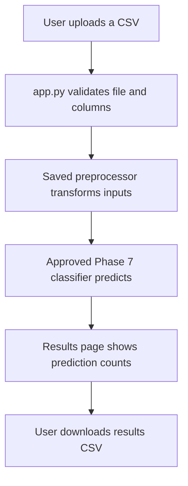
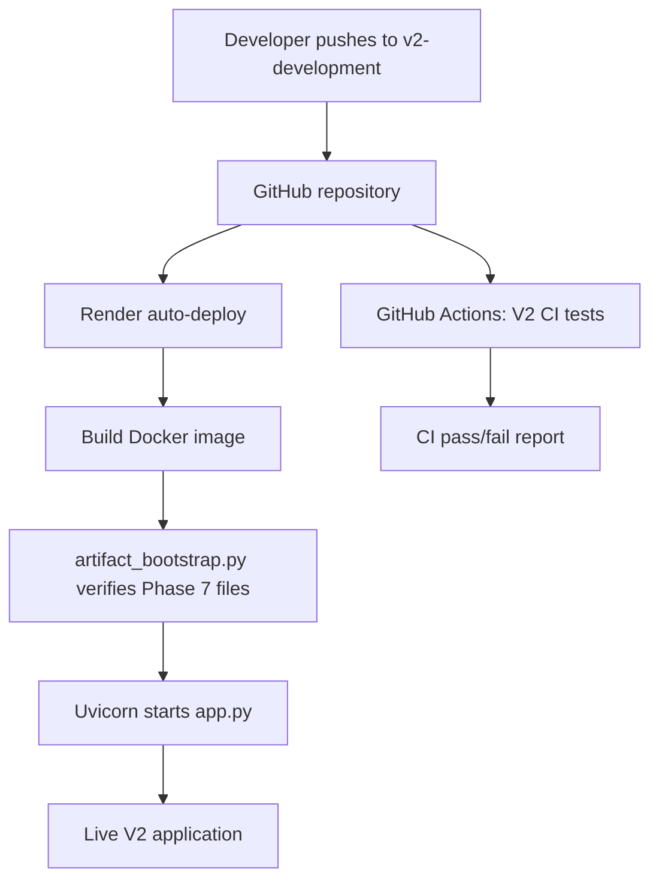

# Phishing Website Detection System

A machine-learning web application that analyzes **prepared website-feature data** and predicts whether each record resembles a phishing website or a legitimate website.

> **Important:** This demo does not scan a website from its URL alone. Upload a CSV containing the 30 required website characteristics. Start with the sample CSV if you are unsure about the format. Predictions are estimates, not a guarantee that a website is safe or malicious.

[**Open the live V2 application**](https://network-security-v2.onrender.com) · [GitHub repository](https://github.com/nakkkul/Network_Security) · [V2 CI workflow](https://github.com/nakkkul/Network_Security/actions/workflows/v2-ci.yml)


## Try the application

1. Open the [live application](https://network-security-v2.onrender.com).
2. Select **Download sample CSV template** to see the required columns and format.
3. Upload a CSV with the same 30 input columns. Do not include the training target column `Result`.
4. Submit the file to analyze each row.
5. Review the prediction counts and download the results CSV.

The prediction labels are `0` = phishing and `1` = legitimate. These are model classifications, not definitive security verdicts.

## What the system does

- Checks that the uploaded CSV has the expected columns and numeric inputs.
- Applies the saved preprocessing pipeline.
- Runs the selected, already-trained classifier.
- Shows a batch results page and offers a downloadable output CSV.
- Verifies the approved V2 model artifact files using SHA-256 before loading them at application startup.

The live inference application does **not** train or retrain a model when someone uploads data.

## Architecture

### Prediction flow



### Deployment flow



**CI and deployment are separate paths in the current setup.** GitHub Actions runs tests on the V2 branch; Render separately watches that branch and deploys pushed changes. A passing CI run is not currently configured as a mandatory deployment gate.

## Machine-learning evaluation and integrity

The controlled V2 workflow uses a canonical dataset of 11,055 rows with 30 input features and a target column named `Result`. The evaluation protocol defines 8,843 outer-training rows and a reserved 2,212-row holdout. Group-aware folds are used for training-only model selection to reduce the risk of identical feature records crossing evaluation boundaries.

The Phase 7 final fit selected **Gradient Boosting** using training-only grouped cross-validation and fitted the selected model on the 8,843 outer-training rows. The reserved holdout was evaluated once in Phase 8 for that frozen model; its evaluation must not be repeated for tuning.

Recorded one-time holdout results:

| Metric | Recorded result |
|---|---:|
| Accuracy | 95.80% |
| Phishing-class F1 | 95.26% |

These are results from the project's fixed evaluation run, not a guarantee of performance on future data. Model provenance for the original V1 artifacts was not sufficient to establish holdout independence, so V2's separate Phase 7 artifact bundle is used for the current deployment.

The application checks the SHA-256 hashes and provenance of the five approved Phase 7 files before loading them. It does not disable integrity checks when a file fails verification.

## Repository structure

```text
Network_Security/
├── app.py                         # Web routes, input validation and predictions
├── main.py                        # Existing training-pipeline entry point
├── artifact_bootstrap.py          # Startup verification for approved V2 artifacts
├── requirements.txt               # Development/training dependencies
├── requirements-deploy.txt        # Smaller, pinned inference dependencies
├── Dockerfile                     # Reproducible inference image definition
├── .dockerignore                  # Excludes data and other unneeded image content
├── .gitignore                     # Excludes local/private/generated files
├── templates/
│   ├── index.html                 # CSV upload page
│   └── table.html                 # Prediction results page
├── static/style.css               # Shared page styling
├── sample_data/                   # Sample CSV for the required input format
├── prediction_output/             # Generated prediction outputs
├── final_model/                   # Preserved legacy V1 .pkl files
├── Artifacts/phase7_final_fit_.../ # Approved V2 model artifacts
├── network_security/              # Reusable ingestion, validation, training and utility code
├── data_schema/                   # Dataset schema definition
├── Network_Data/                  # Canonical local dataset (not needed by live inference)
├── v2_phase2_evaluation/           # Split protocol and evaluation manifests/tests
├── v2_phase6_evaluation/           # Evaluation/final-fit support code
├── evaluation_artifacts/           # Evaluation records, including the one-time holdout report
├── tests/                          # Regression and artifact-verification tests
└── .github/workflows/v2-ci.yml     # V2 test workflow
```

The codebase retains a MongoDB-oriented path for legacy/training-data ingestion. The current Render inference service does not require a separately provisioned MongoDB service to make predictions.

## GitHub Actions: Continuous Integration (CI)

The V2 workflow is `.github/workflows/v2-ci.yml`. It installs pinned test dependencies and runs the configured application/regression suite and the Phase 2 evaluation-protocol tests. The workflow is tests-only: it does not fit or retrain a model, score the reserved holdout, build the production Docker image, or deploy to Render.

CI is useful because it automatically checks expected behavior after code is pushed, instead of relying only on manual testing. A green result means the configured checks passed; it is not proof that every possible defect is absent.

## Docker and Render deployment

The `Dockerfile` builds an image with Python 3.11, pinned dependencies from `requirements-deploy.txt`, the application, the UI templates/static assets, and the approved Phase 7 artifact bundle. The `.dockerignore` keeps the full dataset, evaluation outputs, tests, local environments and other unnecessary files out of the runtime image.

At startup, the container runs:

```sh
python artifact_bootstrap.py && exec uvicorn app:app --host 0.0.0.0 --port ${PORT:-8000}
```

If artifact verification fails, the web server is not started. On Render, the separate `network-security-v2` web service follows the `v2-development` branch and selects the Phase 7 model with `NETWORK_SECURITY_MODEL_VERSION=phase7`.

Render's free service can spin down after inactivity, so the first request after a quiet period may be slow. The live application currently runs on the free service configuration; resource availability and free-tier terms can change.

### Run locally

Use Python 3.11 for compatibility with the saved model artifacts.

```bash
python -m venv .venv
```

On Windows CMD:

```cmd
.venv\Scripts\activate
python -m pip install -r requirements-deploy.txt
set NETWORK_SECURITY_MODEL_VERSION=phase7
uvicorn app:app --reload
```

Open `http://127.0.0.1:8000` in a browser. The `phase7` setting selects the approved V2 bundle; the application also checks its hashes before loading.

### Build and run with Docker

```bash
docker build -t network-security-v2 .
docker run --rm -p 8000:8000 -e PORT=8000 -e NETWORK_SECURITY_MODEL_VERSION=phase7 network-security-v2
```

Docker packages the runtime and dependencies into a repeatable image, reducing differences between the local and hosted environments. It does not replace tests, protect secrets automatically, or improve model accuracy by itself.

## Technologies

- **Application:** Python, FastAPI, Uvicorn, Jinja2
- **Data and ML:** pandas, NumPy, scikit-learn, SciPy, joblib
- **Engineering:** Git, GitHub Actions, automated tests, SHA-256 artifact verification
- **Deployment:** Docker, Render
- **Training/experiment tooling retained in the codebase:** MongoDB-oriented ingestion, MLflow and DagsHub integrations

## Data source

The project's canonical dataset is the UCI Machine Learning Repository's *Phishing Websites* dataset (Dataset ID 327), containing 11,055 instances and 30 input features.

Citation: Mohammad, R. & McCluskey, L. (2012). *Phishing Websites* [Dataset]. UCI Machine Learning Repository. [https://doi.org/10.24432/C51W2X](https://doi.org/10.24432/C51W2X). The dataset is licensed under CC BY 4.0; see the UCI dataset page for terms and attribution details.

## Limitations and responsible use

- The app accepts prepared feature CSVs, not a URL that it visits or scans.
- It processes records in a synchronous web request; very large datasets may not be suitable.
- A prediction may be wrong. Do not rely on this demo as the sole basis for security decisions.
- Avoid uploading sensitive, confidential, or personally identifying information.
- The reserved holdout has already been evaluated once for the frozen Phase 7 model. Do not reuse it to tune future models.

---

This repository includes both a legacy V1 pipeline and the separately controlled V2 development/deployment path. The existing V1 model artifacts and service are kept distinct from the current V2 deployment.
